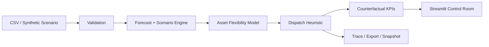

# Grid Flexibility Operations & Scenario Planning Platform

## 1. Product overview
A control-room style grid planning application that forecasts demand, simulates renewable generation and storage, constructs an asset-level flexibility envelope, and evaluates a constraint-aware intervention against a counterfactual baseline.

## 2. Problem
Grid operators must reason about uncertain net load, renewable variability, storage state and controllable demand simultaneously.

## 3. Why the problem matters
A forecast alone does not answer whether the system can respond to a peak event. The operational question is the quantity, timing, duration and recovery cost of available flexibility.

## 4. Architecture

## 5. Core workflow
Configure region, horizon, weather, demand growth, renewable penetration, battery capacity, flexible load and peak event; generate baseline net load; compute flexibility; dispatch storage; compare intervention with baseline; inspect interval-level state and export results.

## 6. Algorithms
EWMA demand forecast, rolling residual uncertainty, probabilistic bands, battery SOC simulation, peak shaving, price-aware charging, upward/downward flexibility envelope and deterministic constraint-aware dispatch heuristic.

## 7. Technical implementation
Pure numerical kernels live in `src/grid_flexibility_engine/engine.py`. Synthetic generation is seeded. Validation is isolated. SQLite stores scenario snapshots. Streamlit cache avoids regenerating identical synthetic datasets.

## 8. Data model
Intervals contain timestamp-like index, hour, demand MW, solar MW, wind MW and price. Configuration contains asset and scenario parameters. Results contain baseline, intervention, SOC, flexibility, cost and trace records.

## 9. Screenshots
The deployed control room contains KPI cards, a net-load counterfactual chart, a flexibility envelope view, interval inspection, decision trace, scenario snapshots and diagnostics.

## 10. Demo instructions
Run `streamlit run app.py`, leave the deterministic demo settings unchanged, and select **Run control-room analysis**. Upload a CSV to replace the synthetic scenario.

## 11. Local setup
Python 3.14.8 target. `pip install -r requirements.txt` then `streamlit run app.py`.

## 12. Streamlit deployment
Create GitHub repository → upload files → Streamlit Community Cloud → select repository → `app.py` → Deploy. No credentials are required.

## 13. Testing
`pytest -q` covers reproducibility, SOC bounds and output invariants.

## 14. Performance considerations
Synthetic generation is cached with `st.cache_data`; calculations are bounded by the selected horizon; runtime is measured at execution time rather than claimed as a benchmark.

## 15. Security considerations
Uploaded CSVs are validated before calculation. No external secrets are needed. Scenario persistence is local SQLite and should be replaced with authenticated external storage for multi-user deployment.

## 16. Scalability path
Demo: one Streamlit process. Small organization: PostgreSQL-backed scenarios. Medium: API/service extraction. Enterprise: stateless workers, external database/cache/queue and utility telemetry integrations.

## 17. Limitations
Travel, network topology, transmission constraints and market settlement are simplified. The flexibility engine is a planning demonstration, not an operational grid-control system.

## 18. Future architecture
Add probabilistic ensemble forecasts, nodal constraints, market bids, real weather feeds, utility SCADA adapters and a formal mathematical programming backend behind the same domain interfaces.

## 19. Example use cases
Peak-event planning, storage sizing, renewable curtailment analysis, flexible-load scheduling and scenario comparison.

## 20. License
MIT.
